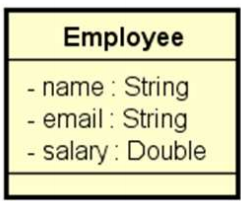

# Problema "funcionários"

Fazer um programa para ler os dados (nome, email e salário) de funcionários a partir de um arquivo em formato .csv.

Em seguida mostrar, em ordem alfabética, o email dos funcionários cujo salário seja superior a um dado valor fornecido
pelo usuário.

Mostrar também a soma dos salários dos funcionários cujo nome começa com a letra 'M'.

## Exemplo de entrada e saída

### Arquivo de entrada (`in.txt`)

#### Para facilitar, copie o arquivo `in.txt` para a pasta `c:\temp\in.txt`.

### Entrada

| Entrada                             | Exemplo                                                                                                                                                             |
|:------------------------------------|:--------------------------------------------------------------------------------------------------------------------------------------------------------------------|
| **Conteúdo do arquivo (`in.txt`):** | `Maria,maria@gmail.com,3200.00` `Alex,alex@gmail.com,1900.00` `Marco,marco@gmail.com,1700.00` `Bob,bob@gmail.com,3500.00` `Anna,anna@gmail.com,2800.00` |
| **Enter full file path:**           | `c:\temp\in.txt`                                                                                                                                                    |
| **Enter salary:**                   | `2000.00`                                                                                                                                                           |

### Saída

| Saída                                                   | Exemplo                                                  |
|:--------------------------------------------------------|:---------------------------------------------------------|
| **Email of people whose salary is more than 2000.00:**  | `anna@gmail.com` `bob@gmail.com` `maria@gmail.com` |
| **Sum of salary of people whose name starts with 'M':** | `4900.00`                                                |                               |

## Utilize a modelagem de classes UML

## 🧠 Conhecimentos e Tecnologias Aplicadas

---

## 👤 Autor

Desenvolvido por Ivan Ferreira.

Copyright © 2026 Ivan Ferreira. Todos os direitos reservados.

## ☕ Sobre

Exercício prático desenvolvido durante os treinamentos de Java da plataforma ⚡**DevSuperior**, ministrados pelo Prof.
Dr. Nélio Alves.