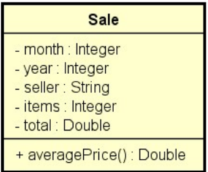

# Problema "Análise de vendas 1"

Fazer um programa para ler um arquivo `.csv` contendo uma base de dados de registros de venda e instanciar na memória
uma lista de objetos do tipo `Sale`, conforme o modelo do projeto.

> **Atenção:** Não use tipos primitivos `int` e `double` nos atributos e métodos! Use os tipos wrapper `Integer`
> e `Double`, conforme mostrado no projeto.

Base de dados `.txt` para testes disponível no repositório do projeto

Depois de ler os dados, seu programa deverá mostrar as seguintes análises (implemente o método `toString` da
classe `Sale` para facilitar):

- Cinco primeiras vendas de 2016 de maior preço médio, ordenadas decrescentemente por preço médio.
- Valor total vendido pelo vendedor Logan nos meses 1 e 7 de qualquer ano.

* **Atenção:** Use métodos Stream + lambda para extrair os resultados a partir da lista original.
* **Atenção:** Caso ocorra alguma falha na leitura do arquivo, a exceção deve ser tratada e mostrada uma mensagem
  conforme exemplo.

## Exemplo de entrada e saída

### Exemplo 1 (Considerando a base de dados acima)

#### Arquivo de entrada (`base-de-dados.txt`)

#### Para facilitar, copie o arquivo `base-de-dados.txt` para a pasta `c:\temp\base-de-dados.txt`.

### Entrada

| Entrada                         | Exemplo                     |
|:--------------------------------|:----------------------------|
| **Entre o caminho do arquivo:** | `c:\temp\base-de-dados.txt` |

### Saída

| Saída                                                       | Exemplo                                                                                                                                                                                                                                      |
|:------------------------------------------------------------|:---------------------------------------------------------------------------------------------------------------------------------------------------------------------------------------------------------------------------------------------|
| **Cinco primeiras vendas de 2016 de maior preço médio**     | `9/2016, Kal-El, 23, 20530.29, pm = 892.62` `7/2016, Kal-El, 20, 17126.62, pm = 856.33` `3/2016, Kal-El, 25, 21099.27, pm = 843.97` `6/2016, Padme Amidala, 25, 16429.74, pm = 657.19` `1/2016, Logan, 12, 7625.55, pm = 635.46` |
| **Valor total vendido pelo vendedor Logan nos meses 1 e 7** | `45357.42`                                                                                                                                                                                                                                   |

### Exemplo 2 (Tratamento de exceção)

### Entrada

| Entrada                         | Exemplo                     |
|:--------------------------------|:----------------------------|
| **Entre o caminho do arquivo:** | `c:\temp\base-de-dados.txt` |

### Saída

| Saída                 | Exemplo                                                                             |
|:----------------------|:------------------------------------------------------------------------------------|
| **Mensagem de erro:** | `Erro: c:\temp\base-de-dados (O sistema não pode encontrar o arquivo especificado)` |

## Utilize a modelagem de classes UML

## 🧠 Conhecimentos e Tecnologias Aplicadas

Neste projeto, foram aplicados conceitos avançados de Programação Orientada a Objetos, Leitura de Arquivos e Programação
Funcional em Java 17 para processar e analisar dados de vendas contidos em um arquivo CSV:

- **Programação Funcional e Streams API:** Utilização de pipelines de `Stream` para manipulação declarativa e eficiente
  de coleções de dados. Foram aplicadas operações como `filter` (para selecionar vendas por ano, vendedor e meses
  específicos), `sorted` (para ordenação decrescente por preço médio calculado), `limit` (para selecionar as 5 maiores
  vendas) e `mapToDouble` / `sum` (para realizar o somatório de vendas).
- **Expressões Lambda e Referências a Métodos (Method References):** Emprego de funções anônimas para maior concisão,
  legibilidade e expressividade na manipulação e filtragem de coleções.
- **Encapsulamento com Tipos Wrapper:** Utilização estrita de classes wrapper (`Integer` e `Double`) nos atributos e
  métodos da classe de domínio `Sale`, evitando o uso de tipos primitivos.
- **Manipulação de Arquivos e I/O de Dados:** Leitura eficiente de arquivo texto (`.csv`) linha a linha utilizando as
  classes `FileReader` e `BufferedReader`, realizando o parsing das informações com `split(",")` e conversões de tipos.
- **Tratamento de Exceções e Gestão de Recursos (try-with-resources):** Utilização do bloco `try-with-resources` para a
  abertura de streams de arquivo, garantindo o fechamento automático dos recursos e exibindo mensagens de erro tratadas
  em caso de falhas de E/S (`IOException`).
- **Orientação a Objetos e Modelo de Domínio:** Criação da entidade `Sale` com encapsulamento adequado, método para
  cálculo derivado (`averagePrice()`) e sobrescrita do método `toString()` para formatação customizada das saídas.

---

## 👤 Autor

Desenvolvido por Ivan Ferreira.

Copyright © 2026 Ivan Ferreira. Todos os direitos reservados.

## ☕ Sobre

Desafio prático desenvolvido durante os treinamentos de Java da plataforma ⚡**DevSuperior**, ministrados pelo Prof.
Dr. Nélio Alves.