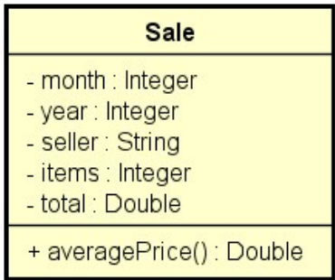

# Problema "Análise de vendas 2"

Fazer um programa para ler um arquivo `.csv` contendo uma base de dados de registros de venda e instanciar na memória
uma lista de objetos do tipo `Sale`, conforme o modelo do projeto.

> **Atenção:** Não use tipos primitivos `int` e `double` nos atributos e métodos! Use os tipos wrapper `Integer`
> e `Double`, conforme mostrado no projeto.

Base de dados `.csv` para testes está disponível no repositório deste projeto.

Depois de ler os dados, seu programa deverá mostrar o total vendido por cada vendedor conforme exemplo (a ordem em que
os vendedores são mostrados não importa).

- **Atenção:** Seu programa é que deve varrer toda a lista para encontrar os nomes dos vendedores.
- **Atenção:** Use métodos Stream + lambda para extrair os resultados a partir da lista original (e/ou coleções
  como `Set` / `Map`).
- **Atenção:** Caso ocorra alguma falha na leitura do arquivo, a exceção deve ser tratada e mostrada uma mensagem
  conforme exemplo.

## Exemplo de entrada e saída

### Exemplo 1 (Considerando a base de dados acima)

#### Arquivo de entrada (`base-de-dados.txt`)

#### Para facilitar, copie o arquivo `base-de-dados.txt` para a pasta `c:\temp\base-de-dados.txt`.

### Entrada

| Entrada                         | Exemplo                     |
|:--------------------------------|:----------------------------|
| **Entre o caminho do arquivo:** | `c:\temp\base-de-dados.txt` |

### Saída

| Saída                             | Exemplo                                                                                                                                                                                                                                               |
|:----------------------------------|:------------------------------------------------------------------------------------------------------------------------------------------------------------------------------------------------------------------------------------------------------|
| **Total de vendas por vendedor:** | `Logan - R$ 220443.05` `Rachel Roth - R$ 502478.67` `Padme Amidala - R$ 473104.63` `Victor Von Doom - R$ 478657.40` `Barry Allen - R$ 499946.28` `Anakin - R$ 477153.54` `Kal-El - R$ 444881.58` `Wanda Maximoff - R$ 470741.34` |

### Exemplo 2 (Tratamento de exceção)

### Entrada

| Entrada                         | Exemplo                 |
|:--------------------------------|:------------------------|
| **Entre o caminho do arquivo:** | `c:\temp\base-de-dados` |

### Saída

| Saída                 | Exemplo                                                                             |
|:----------------------|:------------------------------------------------------------------------------------|
| **Mensagem de erro:** | `Erro: c:\temp\base-de-dados (O sistema não pode encontrar o arquivo especificado)` |

## Utilize a modelagem de classes UML

---

## 👤 Autor

Desenvolvido por Ivan Ferreira.

Copyright © 2026 Ivan Ferreira. Todos os direitos reservados.

## ☕ Sobre

Desafio prático desenvolvido durante os treinamentos de Java da plataforma ⚡**DevSuperior**, ministrados pelo Prof. Dr.
Nélio Alves.